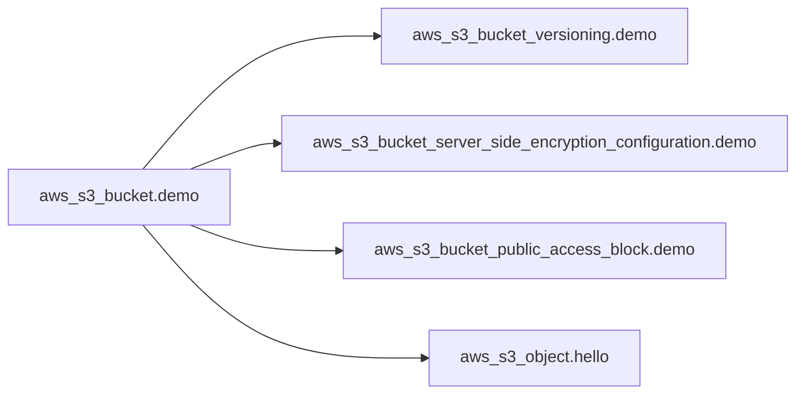
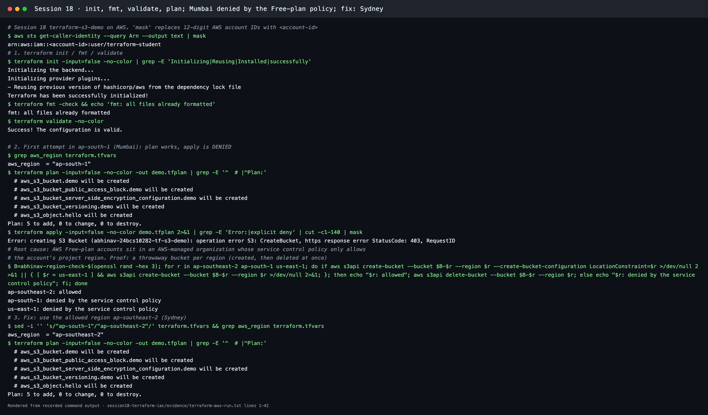
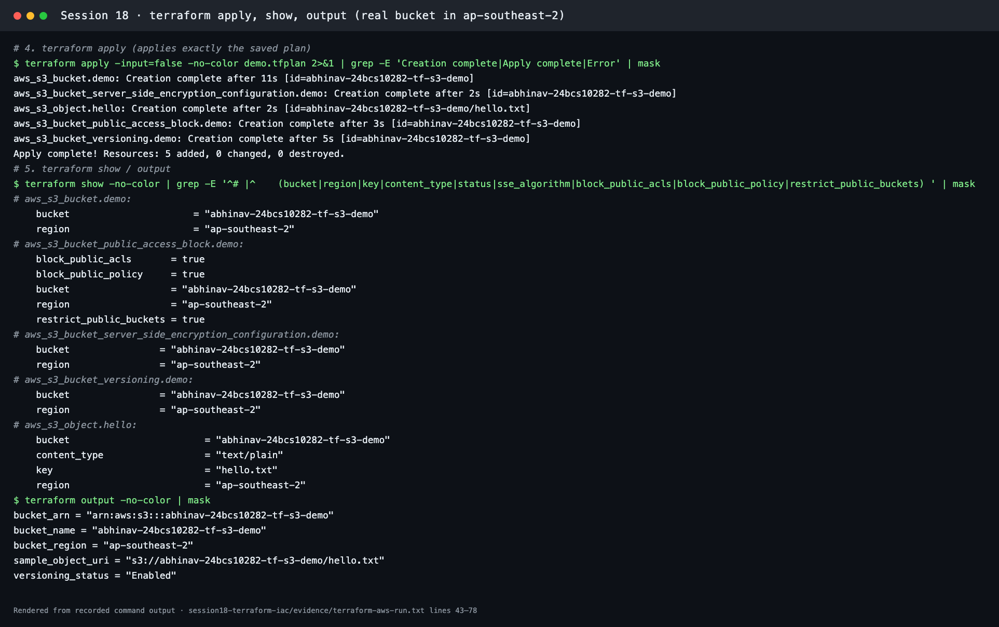
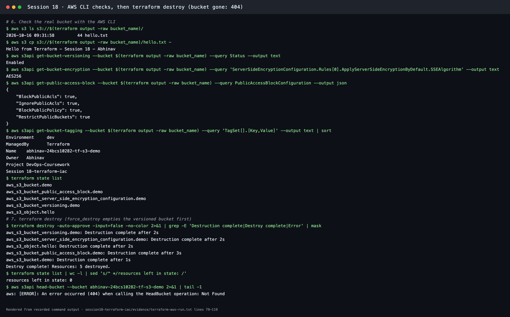

# Terraform S3 Demo

**Session 18 · Task 1** · Author: Abhinav (24BCS10282)

This project creates one **private, versioned, encrypted S3 bucket** with a sample object, using Terraform and the AWS provider. Every resource gets the tags `Project`, `Session`, `Owner` and `ManagedBy=Terraform` from the provider's `default_tags`.

| File | Contents |
| --- | --- |
| [provider.tf](provider.tf) | `terraform { required_version >= 1.6.0, aws ~> 6.68 }` and `provider "aws"` with `region = var.aws_region` and `default_tags` |
| [variables.tf](variables.tf) | `aws_region` (default `ap-southeast-2`), `bucket_name` (with a `validation` regex for S3 naming rules), `environment`, `owner` |
| [main.tf](main.tf) | `aws_s3_bucket.demo` (`force_destroy = true` so that destroy can empty it), `aws_s3_bucket_versioning` (Enabled), `aws_s3_bucket_server_side_encryption_configuration` (AES256 / SSE-S3), `aws_s3_bucket_public_access_block` (all four flags true), `aws_s3_object.hello` (`hello.txt`) |
| [outputs.tf](outputs.tf) | `bucket_name`, `bucket_arn`, `bucket_region`, `versioning_status`, `sample_object_uri` |
| [terraform.tfvars](terraform.tfvars) | `bucket_name = "abhinav-24bcs10282-tf-s3-demo"` (globally unique), `aws_region = "ap-southeast-2"`, environment and owner. **No credentials** |
| [.terraform.lock.hcl](.terraform.lock.hcl) | Provider version and checksums, committed so that everyone gets the same provider build |



All four child resources reference `aws_s3_bucket.demo.id`, so Terraform creates the bucket first and destroys it last. `terraform graph` shows exactly this order (see below).

## Workflow

### 1. `terraform init`, `fmt`, `validate`

```bash
cd session18-terraform-iac/terraform-s3-demo
terraform init        # downloads hashicorp/aws into .terraform/, honours .terraform.lock.hcl
terraform fmt         # canonical formatting (-check to only report)
terraform validate    # syntax, types and references; no AWS calls
```

Recorded run ([evidence/terraform-local-checks.txt](../evidence/terraform-local-checks.txt)):


### Run it on AWS (recorded)

These steps call AWS APIs, so they need credentials:

- `aws login`: browser sign-in with temporary credentials
- `aws configure`: an IAM user's access key (here the IAM user `terraform-student`)

Check with `aws sts get-caller-identity`. Credentials never go into `.tf` or `.tfvars` files.

All of the following ran against a real AWS account ([evidence/terraform-aws-run.txt](../evidence/terraform-aws-run.txt)). The transcript replaces the 12-digit account ID with `<account-id>`.

| Step | Command | Result |
| --- | --- | --- |
| Plan | `terraform plan -out demo.tfplan` | `Plan: 5 to add, 0 to change, 0 to destroy.` |
| First apply | `terraform apply demo.tfplan` (region `ap-south-1`) | **403 AccessDenied:** *explicit deny in a service control policy* |
| Investigate | Create a throwaway bucket in 3 regions | `ap-southeast-2` allowed, `ap-south-1` and `us-east-1` denied |
| Fix | `aws_region = "ap-southeast-2"` in `terraform.tfvars`, plan again | `Plan: 5 to add` |
| Apply | `terraform apply demo.tfplan` | `Apply complete! Resources: 5 added`, bucket created in about 11 s |
| Show / output | `terraform show`, `terraform output` | Bucket in `ap-southeast-2`, all four public-access flags `true`, `versioning_status = "Enabled"` |
| Check with the AWS CLI | `aws s3 ls`, `aws s3 cp …/hello.txt -`, `get-bucket-versioning`, `get-bucket-encryption`, `get-public-access-block`, `get-bucket-tagging` | `Hello from Terraform - Session 18 - Abhinav`, `Enabled`, `AES256`, four × `true`, and the six tags from `default_tags` plus the resource tags |
| Destroy | `terraform destroy -auto-approve` | `Destroy complete! Resources: 5 destroyed.` State is empty, and `head-bucket` returns **404 Not Found** |

**Why the first apply was denied.** New AWS accounts on the **Free plan** belong to an AWS-managed organization. Its service control policy (SCP) only allows the account's own project region, here Sydney (`ap-southeast-2`). An SCP is a guard-rail above IAM, so even `AdministratorAccess` cannot override it (see [IAM → SCP](../aws-services/01-iam/README.md)). `terraform plan` still worked, because planning only reads. The error appeared only when Terraform tried to create the bucket.







## What each step teaches

- **init:** providers are plugins, versioned and locked like application dependencies.
- **validate vs plan:** `validate` is offline and checks the code. `plan` is online and compares the code with reality.
- **apply:** only the planned actions run. Saving the plan (`-out`) guarantees that what you reviewed is what gets applied.
- **show / output:** the state is the source of truth for IDs and ARNs, and outputs expose them to people and scripts.
- **destroy:** dependencies are torn down in reverse order (children first, then the bucket).

## Security notes

- The bucket is private (Block Public Access) and encrypted at rest (SSE-S3). Versioning protects against overwrites and deletes.
- `terraform.tfstate` (and its backup) is git-ignored by [.gitignore](.gitignore): state files can contain sensitive values and must never be committed.
- No access keys exist anywhere in this folder. The provider uses the standard AWS credential chain.
